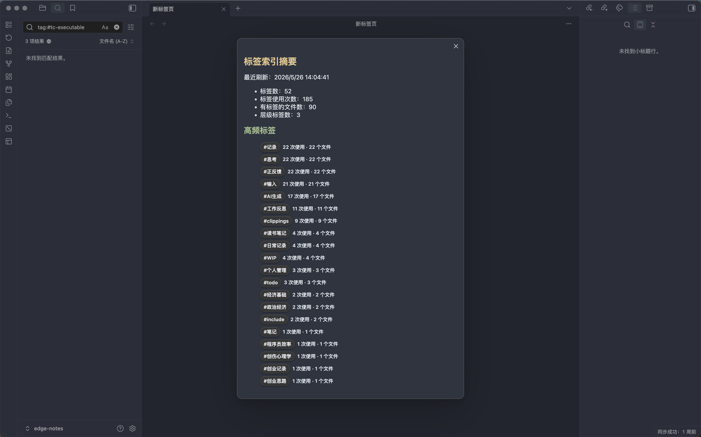
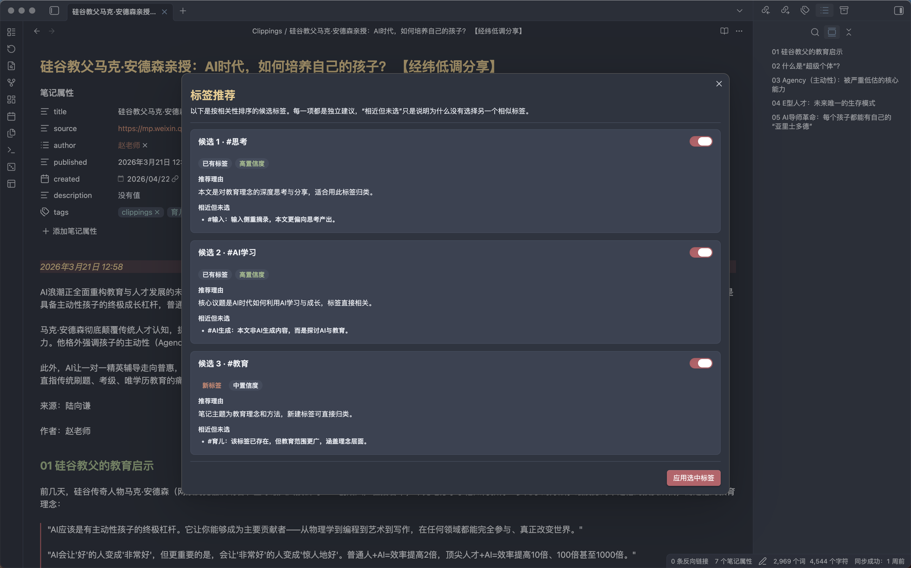
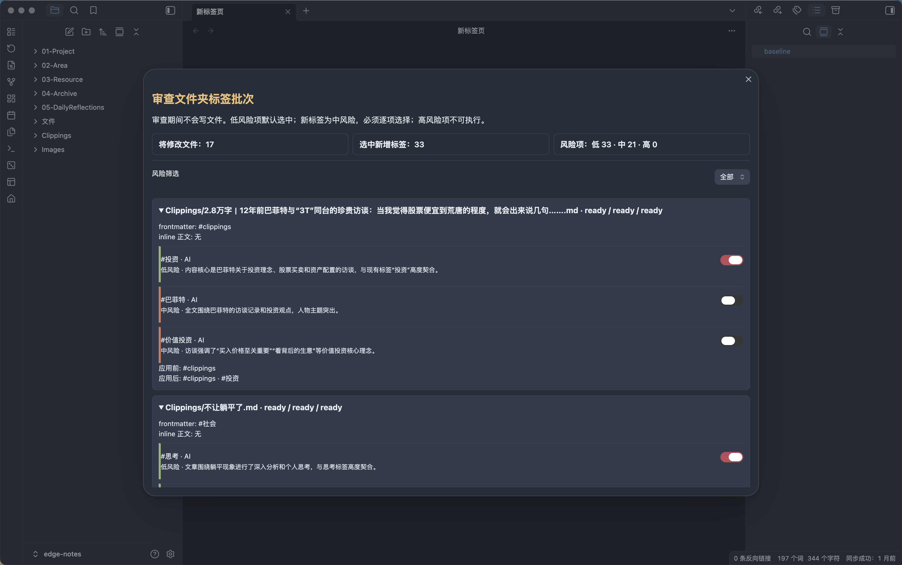
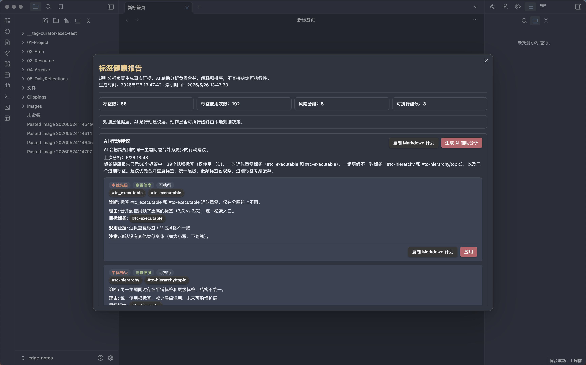
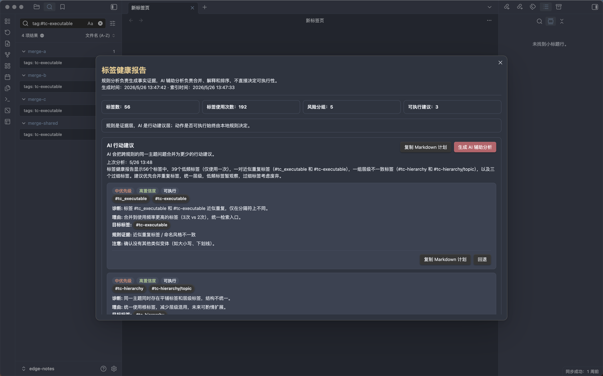
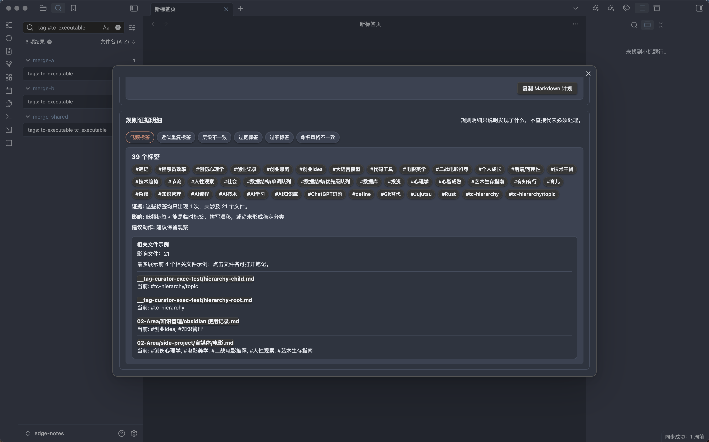
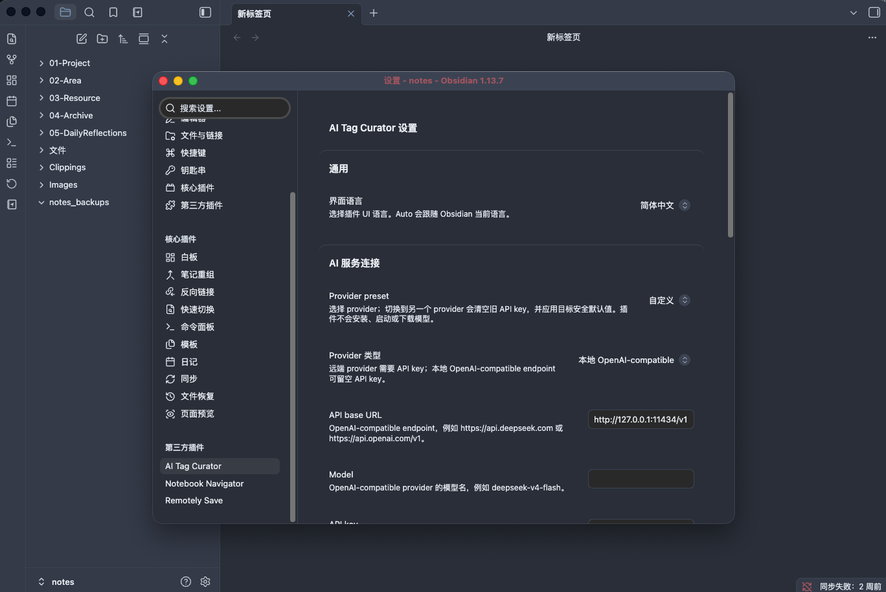
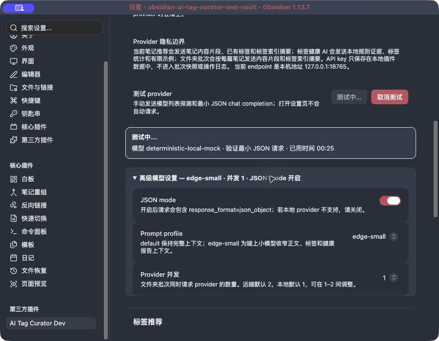

# Obsidian AI Tag Curator

[简体中文](README.zh-CN.md) | English

AI tag management and governance for Obsidian vaults.

AI Tag Curator is not a generic "generate tags for this note" plugin. It helps you keep an existing Obsidian tag taxonomy coherent by reusing known tags, explaining recommendations, and surfacing vault-level tag problems before any risky cleanup work.

This checkout includes the **local tag management workbench under development**. It is not a new release. Automated regression, browser screenshots, installed Obsidian 1.13.7 acceptance, and remaining minimum-version gates are recorded separately in the [workbench verification report](docs/verification/tag-management-workbench.md) (Chinese).

## Current MVP Capabilities

**Local tag management workbench (development)**
- Open `Tag manager` from the command palette or the tags ribbon icon without a provider, API key, or active Markdown note. Browsing and manual rename/merge do not require AI; AI recommendations remain optional, separate workflows.
- Search tags by literal substring, filter sources and folder scope, and browse 100 tags or 50 related notes per page. Counts mean distinct files, including separate frontmatter/inline source file counts, not exact body-token counts.
- Inspect the exact tag's notes, rename one tag, or merge selected source tags into one target through file/occurrence review and confirmation. A manual plan is limited to 200 candidate files; larger scopes are blocked, not truncated.
- Match tag identities case-insensitively but preserve accepted target spelling. Renaming `project` does not rename `project/active`; case-only changes such as `Tag` to `TAG`, deletion, and automatic descendant propagation are unsupported.
- Keep browsing scope separate from global exclusions/protected tags. Source filtering is not write authorization: frontmatter and body selections remain explicit in review. New forward writes must obey the shared policy and preserve unselected raw tag values.
- Display missing/current/outdated/refreshing/error index state. Refresh uses at most four reads, including pending reads from cancelled scans; incomplete scans never become current. File events mark the index outdated rather than triggering a full scan per event.
- Inspect mixed operation history. Undo is limited to the **globally latest active operation**, across recommendation, batch, and cleanup types, even when newer operations touch different files. History filters and old undo commands cannot bypass that order.
- Legacy multi-file cleanup records without V2 recovery evidence are read-only, including when they are newest; they cannot be used to bypass newer history or manufacture an undo plan. Unresolved or unknown recovery records block new writes.

**Vault tag index**

- Build a tag index from Obsidian metadata, frontmatter tags, and optional inline tags.
- Show a tag index summary with tag counts, usage counts, file counts, and top tags.
- Reuse a current index for recommendations and health reports; a loaded cache starts outdated and can be browsed read-only until refreshed. Legacy summary usage counts are not exact body-token counts.

**Current note recommendations**

- Suggest tags for the current Markdown note.
- Prefer existing vault tags, even when new tags are allowed.
- Treat frontmatter and inline body tags as one source-aware note inventory, and filter both from AI suggestions.
- Default-select inline tags that are missing from frontmatter so the formatter-facing frontmatter can represent all reviewed note tags; each item can be deselected.
- Explain each recommendation with confidence and close alternatives not selected.
- Apply selected recommendations only after user confirmation.
- Undo a current-note change only when it is also the globally latest eligible active operation in the development workbench.
- Bind previews to a SHA-256 snapshot of the full Markdown and reject stale content before writing.
- Run slow AI requests in the background and show results when ready.

**Safe folder batch preview**



- Start from the active note's parent folder, choose any other vault folder or the vault root, and include subfolders by default.
- Confirm the full Markdown file count and estimated one-request-per-note cost before any content read, index build, or provider request.
- Enforce a configurable complete-batch limit of 1-200 files (default 50) without silently truncating the scope.
- Generate source-aware candidates with at most two concurrent AI requests; cancellation immediately stops new work, discards late results, and warns that in-flight provider requests may still be billed.
- Keep locally derived inline-to-frontmatter sync items available when AI fails, and retry only failed read/AI items.
- Review frontmatter, inline, and AI sources per file; low-risk inline/existing-tag additions start selected, new tags are medium risk and require individual selection, and destructive actions are not executable.
- Apply only after a second whole-batch confirmation, using full preflight, per-file snapshot checks, reverse compensation, and a persisted fixed recovery target if compensation is incomplete.
- Undo a folder batch as one operation, including after an Obsidian/plugin reload, only when it is the globally latest eligible active operation.
- Never rewrite note bodies or remove inline tags in the folder workflow.

**Vault-level tag health report**
- Organize vault-level tag health into overview, AI priority actions, and rule evidence details.
- Group health issues such as low-frequency tags, near duplicates, hierarchy inconsistencies, over-broad tags, over-narrow tags, and naming drift.
- Use rule analysis for factual evidence and action safety boundaries; use AI assistance for merging related issues, explaining rationale, ranking priorities, and adding risk notes.
- Show user-facing AI action cards with priority, confidence, actionability, diagnosis, rationale, target tags, rule evidence, and caution notes.
- Cache AI-enhanced analysis for the current tag index and show the last analysis time when reopening the report.
- Executable deterministic merge/rename suggestions hydrate frontmatter diffs and individual body `#tag` occurrences; only positions that exactly match Obsidian `TagCache.position` are writable.
- Frontmatter and each body occurrence can be deselected independently. Partial cleanup shows the remaining source count and requires a second confirmation.
- Apply uses full-content/body hashes, token-slice validation, and callback-time CAS inside `Vault.process`; frontmatter and body edits share one compensating, recoverable V2 transaction.
- Observation, broad split, deprecation/removal actions, and body occurrences with missing or stale cache positions remain view-only or manual-review.
- Copy AI action and cleanup suggestions as Markdown for external review.
- Click health report tags to copy and search them in Obsidian.
- Keep long reports scrollable inside a stable modal layout.





**Settings**


- Support remote OpenAI-compatible providers such as DeepSeek and OpenAI, plus local OpenAI-compatible endpoints such as Ollama, LM Studio, and LiteRT-LM CLI.
- Local providers may leave the API key blank, disable JSON mode, and default to the smaller `edge-small` prompt profile with one concurrent folder-batch request.
- Group settings into General, AI service connection, Advanced model settings, Tag recommendations, Indexing and batch, and Diagnostics and feedback; advanced model settings are collapsed by default.
- Provide an explicit provider test with persistent stage and elapsed-time feedback, cancellation, late-result isolation, and a disclosure of which content the current endpoint receives.
- Show dev-mode timing for tag recommendations and AI-enhanced health analysis.
- Support Chinese, English, and `Auto` language mode following Obsidian.
- Configure the maximum complete folder batch size from 1 to 200 files.

## Provider Configuration

Choose a `Provider preset` first, then configure as needed:

- `Provider type` (shown only for the `Custom` preset)
- `API base URL` (read-only for standard presets and editable for `Custom`)
- `API key` (required for remote providers, optional for local providers)
- `Model`
- `JSON mode`
- `Prompt profile`
- `Provider concurrency`

Example OpenAI-compatible settings:

| Provider | Type | API base URL | API key | Model example |
| --- | --- | --- | --- | --- |
| OpenAI | Remote | `https://api.openai.com/v1` | Required | `gpt-4o-mini` |
| DeepSeek | Remote | `https://api.deepseek.com` | Required | `deepseek-chat` |
| Ollama | Local | `http://127.0.0.1:11434/v1` | Optional | `qwen3.8:27b` |
| LM Studio | Local | `http://127.0.0.1:1234/v1` | Optional | The locally loaded model name |
| LiteRT-LM CLI | Local | `http://127.0.0.1:9379/v1` | Optional | The model exposed by `litert-lm serve` |

The API key is stored locally in Obsidian plugin data and is not written into folder-batch snapshots or operation logs. The plugin does not install, start, download, or manage local models. If a local endpoint is not `127.0.0.1` / `localhost`, settings and folder-scope confirmation warn that content is sent to that address.

Apple Foundation Models, Android Gemini Nano/AICore, Chrome Prompt API, and LiteRT-LM JS are not bundled directly into the Obsidian plugin runtime. This stage only connects through an explicit local OpenAI-compatible endpoint. See the Chinese [on-device model support research](docs/on-device-model-support-research.zh-CN.md).

### Ollama + Qwen3.8 quick start

This path was validated on an Apple M2 Pro with 32GB unified memory using Ollama `0.32.15` and the approximately 17GB `qwen3.8:27b` model. Choose a smaller model on machines with less available memory.

1. Install and start Ollama:

```bash
brew install --cask ollama-app
ollama --version
```

Launch the Ollama app. When you need to run the service manually, use `ollama serve`.

2. Download and confirm the model:

```bash
ollama pull qwen3.8:27b
ollama list
```

3. Verify the native and OpenAI-compatible APIs:

```bash
curl -fsS http://127.0.0.1:11434/api/version
curl -fsS http://127.0.0.1:11434/v1/models
curl -fsS http://127.0.0.1:11434/v1/chat/completions \
  -H 'Content-Type: application/json' \
  -d '{"model":"qwen3.8:27b","messages":[{"role":"user","content":"Return exactly {\"ok\":true} as JSON."}],"stream":false}'
```

4. In the plugin's **AI service connection** group, select:

- Provider preset: `Ollama`
- API base URL: `http://127.0.0.1:11434/v1` (managed by the preset)
- Model: `qwen3.8:27b`
- API key: blank
- Advanced model settings: `edge-small`, concurrency `1`; JSON mode starts off and can be enabled after a successful compatibility test
- Click **Test connection** and keep the settings page open for the persistent stage, elapsed time, and final result

Switching providers clears the previous API key and applies safe destination defaults. Local model tests and recommendations may take several minutes. Cancelling discards late UI results, but a request already sent to Ollama may continue inference until it settles.

### Capability boundary

The plugin currently uses text `chat/completions` and requires parseable structured JSON. Even when Ollama, LocalAI, or another runtime supports more, the plugin does not currently call vision, image generation, speech, embeddings, tools/agents, streaming, or native Apple/Google on-device SDKs.

### Troubleshooting

- Endpoint unreachable: confirm Ollama is running, then check `lsof -nP -iTCP:11434 -sTCP:LISTEN` and `/api/version`.
- Model 404: run `ollama list` and use the exact model name in plugin settings.
- JSON mode / `response_format` incompatibility: expand **Advanced model settings**, turn JSON mode off, and test again.
- Non-JSON response: keep `edge-small`, confirm the model follows structured-output instructions, or choose a model with stronger instruction following.
- Slow inference: run `ollama ps`, avoid keeping multiple large models resident, reduce batch concurrency, or use a smaller model.

## Local Installation

1. Install dependencies:

```bash
npm install
```

2. Build the plugin:

```bash
npm run build
```

3. Create a plugin directory in your target Obsidian vault:

```bash
mkdir -p /path/to/your-vault/.obsidian/plugins/ai-tag-curator
```

4. Copy the generated files:

```bash
cp main.js manifest.json styles.css .hotreload /path/to/your-vault/.obsidian/plugins/ai-tag-curator/
```

5. Open Obsidian, go to `Settings -> Community plugins`, and enable `AI Tag Curator`.

Generated plugin files:

- `main.js`
- `manifest.json`
- `styles.css`
- `.hotreload` for local development with the [Hot Reload](https://github.com/pjeby/hot-reload) plugin

For local development, you can install directly into an Obsidian vault:

```bash
OBSIDIAN_VAULT_PATH=/path/to/your-vault npm run local:install
```

To install a side-by-side development copy without replacing the Marketplace plugin:

```bash
OBSIDIAN_VAULT_PATH=/path/to/your-vault npm run local:install-dev
```

The install script requires an explicit `OBSIDIAN_VAULT_PATH` so it cannot silently write to the wrong or unregistered Obsidian vault.

### Release screenshot vault

Prepare or reset the dedicated synthetic vault used for real Obsidian smoke tests and release screenshots:

```bash
OBSIDIAN_RELEASE_VAULT_PATH=/path/to/test-vault npm run release:vault:prepare
```

`OBSIDIAN_RELEASE_VAULT_PATH` is required because the command resets the synthetic release notes. It installs the development plugin and disables Obsidian Sync. The default Obsidian appearance is used unless an optional theme-source vault is provided:

```bash
OBSIDIAN_RELEASE_VAULT_PATH=/path/to/test-vault \
OBSIDIAN_THEME_SOURCE_VAULT=/path/to/theme-source \
npm run release:vault:prepare
```

Only the active appearance configuration, its theme directory, and the core-plugin configuration are copied from the optional theme source. Personal notes and credentials are never copied.

Start the deterministic local provider before exercising AI-backed release flows:

```bash
npm run release:mock
```

The mock listens on `127.0.0.1:18765`, keeps external APIs and real credentials out of the screenshot workflow, and adds a short response delay so progress and cancellation states can be verified.

After building a release candidate, verify version metadata and print the size and SHA-256 digest of every required release asset:

```bash
npm run build
npm run release:verify
```

## Usage

### Local management without AI (development)

1. Open `Tag manager` or use the tags ribbon icon. No provider setup or active note is required.
2. Refresh an absent/outdated index, search and select exact tags, and confirm scope and protection rules.
3. Review rename/merge differences and confirm selected changes; use History to inspect the result and the globally latest eligible undo/recovery action.

This workflow remains subject to the [uncompleted acceptance gates](docs/verification/tag-management-workbench.md). Use an isolated, backed-up synthetic vault for development verification.

### Optional AI workflows

1. Configure provider type, preset, API base URL, API key (blank is allowed for local providers), and model.
2. Run `Refresh vault tag index`.
3. Open a Markdown note.
4. Run `Suggest tags for current note`.
5. Review the recommendation modal and apply only the tags you want.
6. Run `Generate tag suggestions for folder` to confirm a folder scope, generate candidates, and review a whole batch before writing.
7. Use History or `Undo latest folder batch tag operation` to revert a batch only if it is the globally latest eligible operation.
8. Run `Analyze tag health` to inspect vault-level tag problems.
9. Optionally run `AI-enhanced analysis` inside the health report.
10. Use History or `Undo last tag curator change` for a current-note write only if it is the globally latest eligible operation; resolve unfinished recovery before starting new writes.

## Commands

The plugin UI defaults to `Auto`, which follows the current Obsidian language. In English, the commands are:

- `Tag manager` (development workbench)
- `Refresh vault tag index`
- `Show tag index summary`
- `Analyze tag health`
- `Suggest tags for current note`
- `Generate tag suggestions for folder`
- `Undo last tag curator change`
- `Undo latest folder batch tag operation`

## Development

Run tests:

```bash
npm test
```

Build:

```bash
npm run build
```

OpenSpec workflow:

```bash
npm run spec:list
npm run spec:status -- --change <change-name>
npm run spec:validate -- <change-name>
```

For new product work, start with an OpenSpec change proposal before implementation.

## Current Limitations

- Current-note and folder workflows still write only frontmatter `tags`; reviewed inline tags may be copied into frontmatter without changing the body.
- Body writes are limited to reviewed deterministic merge/rename in the health report and the development workbench's manual review. Both require selected complete `#tag` tokens with exact cache positions; neither permits fuzzy/global replacement, body additions, deletion, split actions, or AI-generated body writes.
- Manual management targets exact tag identities, not subtrees. Descendant propagation and case-only renaming are unsupported. Invalid targets are rejected rather than silently normalized into a different request.
- Undo follows global operation order, not the latest record of a selected type. Legacy multi-file cleanup is read-only; there is no out-of-order undo or redo. Old records do not prove original tag spelling or formatting that they never stored.
- New exact tag-value patches preserve unselected values, body text, and non-tags property semantics; YAML quoting/formatting may change, and unsupported scalar/mixed tags or unsafe YAML must remain read-only. Back up and finish outstanding undo/recovery before downgrading; old plugins may not understand new raw-value recovery fields.
- The workbench has installed-host Obsidian 1.13.7 evidence and synthetic-browser narrow/wide, light/dark, and keyboard screenshots. Minimum-host (`1.8.7`) and mobile acceptance remain pending; browser evidence does not replace host verification. See the workbench report for exact coverage and limitations.
- Remote providers still require an API key. Local OpenAI-compatible providers may leave it blank, but still require a base URL and model.
- The plugin only calls the explicitly configured provider endpoint. It does not install, start, or download models, and it does not silently fall back to a cloud provider.
- A folder batch must contain 1-200 Markdown files within the configured limit; an oversized scope is blocked rather than truncated.
- Cancellation cannot revoke provider requests already sent, so those in-flight requests may still be billed even though late results are discarded.
- Only additive tag plans are executable in folder batches. Delete, replace, merge, and body-edit actions remain outside the folder workflow boundary.
- Rule evidence in tag health reports is read-only. Executable cleanup items require file previews and explicit manual confirmation.
- AI-enhanced health analysis provides summary and action guidance only; it cannot change local action capability or execute changes.
- Cleanup plans label action capabilities. Executable merge/rename items can be applied manually and undone; other items remain preview-only, observe-only, or manual-review.
- AI responses must be valid structured JSON. If parsing fails, no file is modified.

## Documentation

- [Changelog](CHANGELOG.md)
- [License](LICENSE)
- [Chinese release checklist](docs/release-checklist.zh-CN.md)
- [English product handoff](docs/product-handoff.md)
- [Chinese product explanation](docs/product-handoff.zh-CN.md)
- [Chinese technical design](docs/technical-design.zh-CN.md)
- [Chinese roadmap](docs/roadmap.zh-CN.md)
- [Workbench verification and host gaps (Chinese)](docs/verification/tag-management-workbench.md)
- [OpenSpec project context](openspec/project.md)
