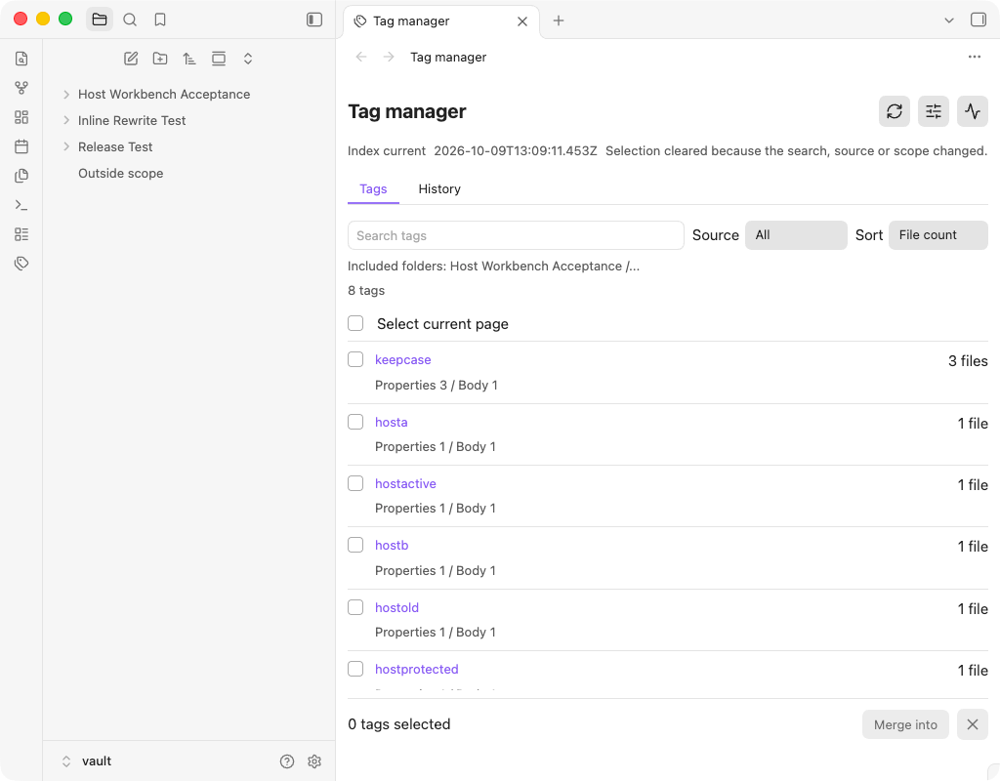

# Obsidian AI Tag Curator

简体中文 | [English](README.md)

**让 Obsidian 标签保持一致：本地浏览、改名与合并，按需使用 AI 建议。**

查看标签关联的笔记，整理重复命名，在修改 Markdown 文件前逐项审查。本地管理无需 API key；需要 AI 时，可以优先复用已有标签，并判断整个库中哪些标签值得整理。

[安装](#安装) · [快速开始](#快速开始) · [使用指南](docs/guide.zh-CN.md) · [版本发布](https://github.com/qmkCamel/obsidian-ai-tag-curator/releases) · [反馈问题](https://github.com/qmkCamel/obsidian-ai-tag-curator/issues)



*Obsidian 1.14.4 中的 0.5.0 工作台，截图来自合成测试库。*

## 可以做什么

| 任务 | 提供的能力 | 是否需要 AI |
| --- | --- | --- |
| 浏览与整理标签 | 搜索、来源与目录筛选、相关笔记、审查后改名或合并 | 不需要 |
| 检查标签健康度 | 重复标签、命名不一致等问题的规则证据 | 不需要；AI 解释和优先级分析可选 |
| 为当前笔记打标签 | 优先复用已有标签，展示理由、置信度，逐项选择 | 生成推荐需要 |
| 为文件夹打标签 | 限定范围、逐笔记审查、最终确认的批次建议 | 生成推荐需要 |
| 查看与撤销修改 | 统一操作历史、未完成操作恢复 | 不需要 |

界面支持简体中文、英文，也可以自动跟随 Obsidian 的语言。

例如，将 `#project-ideas` 和 `#project_ideas` 合并到一个选定标签：先检查受影响笔记和标签位置，再确认应用。未勾选的位置保持不变。将 `#project` 改名不会同时修改 `#project/active`。

## 安装

需要 **Obsidian 1.8.7 或更高版本**。0.5.0 已在 macOS 的 Obsidian 1.8.7 和 1.14.4 上完成验收；Windows、Linux 和移动设备尚未验证。详见[发布验收记录](docs/verification/0.5.0-release-acceptance.zh-CN.md)。

1. 打开[最新版本发布页](https://github.com/qmkCamel/obsidian-ai-tag-curator/releases/latest)。
2. 从同一个版本的 **Assets** 下载 **`main.js`**、**`manifest.json`** 和 **`styles.css`**。
3. 在你的库中创建 `.obsidian/plugins/ai-tag-curator/`，将这三个文件放进去。
4. 重新加载 Obsidian，在 **设置 → 第三方插件** 中启用 **AI Tag Curator**。

这种安装方式不需要 Node.js 或构建工具。源码构建、并排安装开发版见[从源码构建](docs/guide.zh-CN.md#从源码构建)。

升级现有安装前，请备份库与插件数据，处理完未完成操作，并阅读 [0.5.0 升级说明](docs/guide.zh-CN.md#升级到-050)，特别是撤销顺序和旧操作记录的变化。

## 快速开始

先体验本地管理，AI 服务可以之后再配置。

1. 打开命令面板，执行 **标签管理**，或点击侧边栏的标签图标。
2. 如果索引不存在或已过期，先刷新，再搜索标签并查看相关笔记。
3. 选择改名或合并，检查文件、属性标签和正文标签位置，确认所选变更。
4. 在 **历史** 中查看结果，或撤销最近一条符合条件的操作。

批量修改前请先备份库。浏览筛选用于查找标签；**范围与保护**用于设置全局排除目录和受保护标签。最终改哪些位置，由审查中的勾选决定。

只想检查库而不修改时，执行 **分析标签健康度**，无需配置 AI 即可查看规则证据。

## 可选 AI

在 **设置 → AI Tag Curator → AI 服务连接** 中选择服务，填写你可使用的模型，点击 **测试连接**。

| 服务预设 | 连接方式 | API key |
| --- | --- | --- |
| OpenAI / DeepSeek | 远端 OpenAI-compatible 服务 | 必填 |
| Ollama / LM Studio / LiteRT-LM CLI | 你已启动的本地 OpenAI-compatible 服务 | 可留空 |
| Custom | 自行指定的兼容接口 | 取决于服务类型 |

随后打开一篇 Markdown 笔记，执行 **为当前笔记推荐标签**，查看理由并勾选需要的标签后应用。处理多篇笔记时，执行 **为文件夹批量生成标签建议**，先确认范围再生成。

文件夹批次默认最多 50 篇 Markdown，可配置为 1 到 200 篇。超过上限会阻断，不会静默截取部分文件。手动改名或合并也最多审查 200 个候选文件。

健康报告中的 AI 建议会解释诊断、目标标签、优先级与风险。是否可执行由本地规则决定，生成分析不会直接应用修改。

接口配置、JSON 兼容性和慢请求处理见[服务配置、本地模型示例与排查指南](docs/guide.zh-CN.md#provider-配置)。插件连接你提供的模型服务，不会下载或启动模型。

## 数据与修改边界

- **本地流程：** 标签索引、浏览、手动管理和基于规则的健康分析无需 AI 请求。
- **AI 请求：** 推荐会向配置的接口发送有长度限制的笔记内容、路径、已有标签及部分标签索引示例；健康分析发送报告、标签统计及部分文件路径和片段。文件夹推荐逐篇请求。
- **接口选择：** 不会自动回退到云端。即使服务类型设为本地，只要地址指向其他机器，提交的内容也会发送到那台机器。
- **凭据：** API key 保存在 Obsidian 插件数据中，不写入批次快照或操作日志。
- **审查后写入：** 当前笔记和文件夹推荐只更新笔记的 `tags` 属性（YAML frontmatter）。手动管理和健康报告中的改名/合并还可修改逐项审查、位置经过验证的正文 `#tag`。
- **撤销与恢复：** 笔记、批次和清理共用撤销顺序，只能撤销全局最近一条符合条件的活动操作。未完成恢复会阻止新写入；部分旧清理记录只读。
- **限制：** 不支持删除、拆分、仅大小写改名、自动改名子标签或乱序撤销。YAML 引号和排版可能变化。取消 AI 请求无法撤回已发送的工作，服务方仍可能计费。

大范围修改或降级前，请阅读[完整限制说明](docs/guide.zh-CN.md#当前限制)。

## 文档

| 想了解什么 | 文档入口 |
| --- | --- |
| 完整流程、截图与命令 | [使用指南](docs/guide.zh-CN.md) |
| AI 服务配置与排查 | [AI 配置](docs/guide.zh-CN.md#provider-配置) |
| 升级与降级注意事项 | [0.5.0 升级说明](docs/guide.zh-CN.md#升级到-050) |
| 各版本变化 | [双语更新日志](CHANGELOG.md) |
| 已测试平台与发布证据 | [0.5.0 发布验收](docs/verification/0.5.0-release-acceptance.zh-CN.md) |
| 产品方向 | [路线图](docs/roadmap.zh-CN.md) |
| 架构与开发约定 | [技术方案](docs/technical-design.zh-CN.md) · [项目上下文](openspec/project.md) |

## 反馈与贡献

通过 [GitHub Issues](https://github.com/qmkCamel/obsidian-ai-tag-curator/issues) 报告问题或提出建议。请附上插件版本、Obsidian 版本、操作系统、复现步骤、预期结果与实际结果。AI 相关问题请补充服务类型和模型名称，并从日志或截图中移除 API key 和私人笔记内容。

欢迎文档修正、翻译和 bug 修复。新增产品功能先通过 issue 讨论，并创建 OpenSpec 提案，具体见[项目约定](openspec/project.md)。提交信息遵循[中英双语格式](AGENTS.md)。

本地开发使用 [mise.toml](mise.toml) 指定的 Node.js 版本，然后运行：

```bash
git clone https://github.com/qmkCamel/obsidian-ai-tag-curator.git
cd obsidian-ai-tag-curator
npm ci
npm test
npm run build
```

在测试库中并排安装开发版：

```bash
OBSIDIAN_VAULT_PATH=/path/to/test-vault npm run local:install-dev
```

更多步骤见[开发与 OpenSpec 命令](docs/guide.zh-CN.md#开发)和[合成发布测试库](docs/guide.zh-CN.md#发布截图测试库)。

## 许可证

[MIT](LICENSE)，由 [qmkCamel](https://github.com/qmkCamel) 维护。
